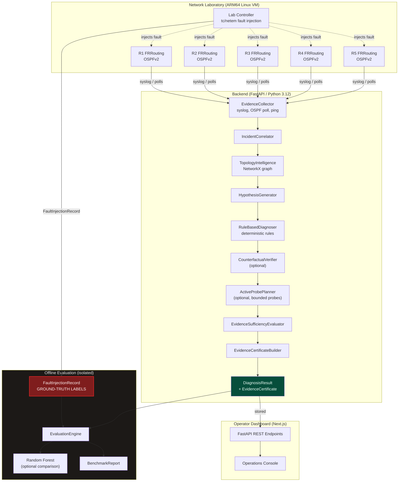

# NEXORA — System Architecture Diagram

**Team**: A3-PS035-TC490 | **PS-035**

---

## Component Key

| Symbol | Component |
|--------|-----------|
| `R1–R5` | FRRouting OSPFv2 containers (Containerlab) |
| `Lab Controller` | Fault injection script (`tc/netem`, container stop) |
| `FaultInjectionRecord` | Ground-truth labels (ISOLATED from inference) |
| `EvidenceCollector` | Multi-source observation ingestion |
| `IncidentCorrelator` | Alarm grouping and deduplication |
| `TopologyIntelligence` | NetworkX graph context |
| `HypothesisGenerator` | Candidate fault generation |
| `RuleBasedDiagnoser` | Deterministic scoring |
| `CounterfactualVerifier` | Optional hypothesis validation |
| `ActiveProbePlanner` | Optional bounded read-only probes |
| `EvidenceSufficiencyEvaluator` | Abstention gating |
| `EvidenceCertificateBuilder` | Audit certificate generation |
| `EvaluationEngine` | Offline-only post-inference comparison |
| `Random Forest` | Optional offline comparison model |
