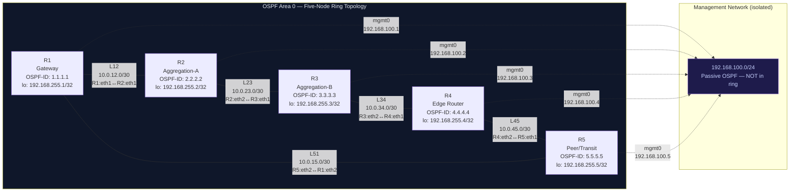

# NEXORA — Five-Node Topology Diagram

**Team**: A3-PS035-TC490 | **PS-035**

---

## Addressing Summary

| Router | OSPF-ID | Loopback | eth1 | eth2 |
|--------|---------|----------|------|------|
| R1 | 1.1.1.1 | 192.168.255.1/32 | 10.0.12.1/30 (→R2) | 10.0.15.2/30 (→R5) |
| R2 | 2.2.2.2 | 192.168.255.2/32 | 10.0.12.2/30 (→R1) | 10.0.23.1/30 (→R3) |
| R3 | 3.3.3.3 | 192.168.255.3/32 | 10.0.23.2/30 (→R2) | 10.0.34.1/30 (→R4) |
| R4 | 4.4.4.4 | 192.168.255.4/32 | 10.0.34.2/30 (→R3) | 10.0.45.1/30 (→R5) |
| R5 | 5.5.5.5 | 192.168.255.5/32 | 10.0.45.2/30 (→R4) | 10.0.15.1/30 (→R1) |

## Link Subnet Summary

| Link | Subnet | Cost |
|------|--------|------|
| L12 (R1–R2) | 10.0.12.0/30 | 1 |
| L23 (R2–R3) | 10.0.23.0/30 | 1 |
| L34 (R3–R4) | 10.0.34.0/30 | 1 |
| L45 (R4–R5) | 10.0.45.0/30 | 1 |
| L51 (R5–R1) | 10.0.15.0/30 | 1 |
