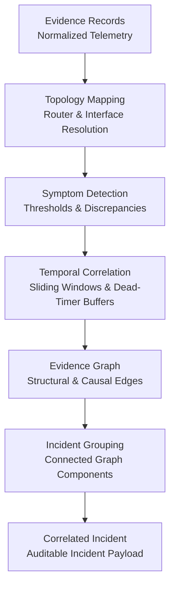

# Incident Correlation Architecture

## Overview

The Incident Correlation Engine transforms high-volume, disparate, and potentially noisy network observations into coherent, localized, and auditable incident groups. In adherence to the core Nexora design philosophy (*"From Correlation to Verification"*), this phase performs deterministic **spatial and temporal grouping** without making premature or unsupported root-cause assertions.

## Correlation Pipeline

### 1. Evidence Ingestion & Sanitization
- Normalized evidence records (`InterfaceObservation`, `OSPFObservation`, `RouteObservation`, `PingMeasurement`, `TracerouteObservation`, `SyslogEvent`) are ingested.
- Inputs are scanned against forbidden ground-truth tokens (`f1_link_failure`, `seeded_fault`, etc.) to prevent leakage.
- Exact and logical duplicates (e.g. repeated periodic polls with identical state within the sliding window) are deduplicated.

### 2. Symptom Detection & Classification
Observations are classified into typed `CorrelatedSymptom` instances:
- `INTERFACE_DOWN`: Physical link or interface down (directly observed).
- `OSPF_ADJACENCY_LOST`: OSPF neighbour transitioned to DOWN or absent from neighbour table.
- `OSPF_ADJACENCY_DEGRADED`: OSPF neighbour stuck in Init, ExStart, or Loading state.
- `ROUTE_MISSING`: Expected prefix absent from local routing table (inferred observation).
- `PACKET_LOSS_ELEVATED`: Measured ping loss exceeding configured threshold (default 5.0%).
- `LATENCY_ELEVATED`: Measured round-trip time exceeding configured baseline threshold (default 10.0 ms).
- `COLLECTION_FAILURE`: Telemetry collector timed out or container was unreachable.
- `HEALTHY`: Baseline normal operation.

### 3. Temporal Window Policy
Network events propagate across routing protocols with predictable delays:
- **Default Sliding Window**: 120 seconds.
- **OSPF Dead-Timer Buffer**: OSPF hello/dead timers (typically 40s dead interval) introduce a lag between physical link drops and protocol neighbor down events. The temporal window accommodates this propagation skew to ensure physical and logical symptoms group together.
- Symptoms occurring outside the temporal correlation window are partitioned into distinct temporal slices to avoid collapsing separate outages into one.

### 4. Evidence Graph & Relationship Types
A directed evidence graph (`EvidenceGraph`) links symptoms using explicit, auditable relationship types:
- `TOPOLOGY_ADJACENCY`: Symptoms occur on routers connected by a direct physical link.
- `OSPF_TOPOLOGY`: Interface drop directly explains adjacent OSPF adjacency loss.
- `SHARED_ROUTER`: Multiple distinct symptoms originate on or implicate the same router.
- `PATH_CONTAINMENT`: Probe path (traceroute/ping) traverses the affected router or link.
- `TEMPORAL_COINCIDENCE`: Symptoms occur within the same temporal window without direct physical adjacency.

### 5. Incident Grouping Logic
Incident groups are formed by finding connected components on the graph of topologically and temporally correlated symptoms:
- Single-router anomalies group around the affected router.
- Link drop anomalies group the local interface down, remote OSPF neighbour loss, and subsequent route withdrawal.
- Unrelated concurrent events in distinct topology zones or disjoint time windows form separate `CorrelatedIncident` entities.
- Contradictory observations (e.g., interface reported UP by iproute2 but DOWN by FRR OSPF) are retained explicitly in `contradictory_observations` rather than silently reconciled or dropped.

## Dependency and Double-Counting Risks

A central hazard in network fault localisation is double-counting downstream symptoms:
- When a router goes down, all 4 of its adjacent peers will log lost adjacencies, ping drops, and route withdrawals.
- The correlation engine captures these symptoms under structured dependency edges rather than multiplying severity scores.
- Observations with `is_direct_observation: false` (such as route absence) are clearly differentiated from primary direct observations.

## Boundaries: Correlation vs. Diagnosis

> [!IMPORTANT]
> The Correlation Engine does **NOT** rank root-cause hypotheses, predict failure causes, or perform diagnostic inference.
> It produces bounded, auditable incident groups with complete provenance.
> Root-cause hypothesis formulation, counterfactual verification, and diagnostic ranking are reserved for **Phase 06**.
